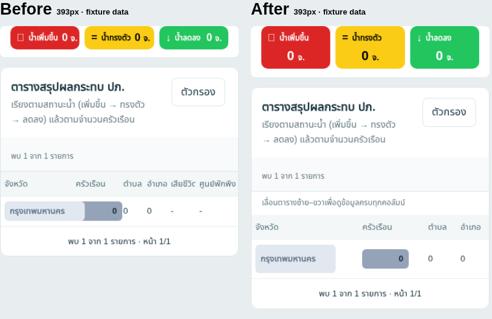

# รีวิว responsive บนมือถือ

Branch: `review/mobile-responsive`

## ขอบเขต

รีวิวก่อนแก้ UI ตามคำขอ ใช้ Chromium กับ `docs/index.html` ที่มีอยู่ใน repository และข้อมูลจำลองจาก `flood_web/fixture_server.py` ตรวจ viewport 360, 393, 768, 1024 และ 1440px สูง 844px โดยอ่าน source ใน `flood_web/` ประกอบ ยังไม่เปลี่ยน UI

ปิด network ภายนอกระหว่างตรวจ จึงใช้ฟอนต์ fallback, แผนที่แสดง fallback และข้อมูลข่าว/DOH ไม่ครบ หน้า risk/news/DOH ที่ไม่มีข้อมูลยังไม่ถือว่าผ่านการตรวจเมื่อมีข้อมูลจริง ผลนี้ไม่ยืนยัน Safari หรือปัญหาหน้า reload/crash บน iPhone

## ข้อค้นพบและข้อเสนอ

### 1. ตารางสรุปปฏิบัติการ: ชื่อจังหวัดเบียดทับคอลัมน์ข้างเคียง — ควรแก้ก่อน

- ที่ 393px พื้นที่ `#sideBody.ops-summary` กว้าง 367px แต่เนื้อหากว้าง 430px; ที่ 360px เท่ากับ 334/403px
- ภาพตรวจพบปุ่มชื่อกรุงเทพมหานครกินพื้นที่คอลัมน์ครัวเรือน
- Source: `flood_web/dashboard.css` ส่วน `.province-chip` และ `#sideBody.ops-summary table` (ประมาณบรรทัด 409–414): ปุ่มมี `min-width:9.5em` แต่ตารางใช้ fixed layout และคอลัมน์จังหวัด 30%
- เสนอให้ตารางมีความกว้างขั้นต่ำตามข้อมูลและเลื่อนภายในกรอบบนมือถือ พร้อมข้อความบอกว่าเลื่อนดูคอลัมน์เพิ่มเติมได้ ยกเลิกการบีบคอลัมน์แบบเปอร์เซ็นต์ในช่วงหน้าจอแคบ พิจารณาตรึงคอลัมน์จังหวัด โดยตรวจไม่ให้บังตัวเลขและ focus
- ตรวจซ้ำ tablet/desktop ด้วย เพราะพบเนื้อหาเกินกรอบใน 1024/1440px เช่นกัน

### 2. การ์ดแนวโน้ม 3 ช่อง: เนื้อหาล้นที่ 360px — ควรแก้ก่อน

- `.trend-card.tc-up` กว้าง 95px แต่เนื้อหา 103px; `.tc-steady` เนื้อหา 101px แม้ข้อมูลจำนวนจังหวัดเป็นศูนย์
- Source: `flood_web/dashboard.css` ส่วน `.trend-cards` / `.trend-card` ประมาณบรรทัด 405–408
- เสนอคง 3 ช่องแต่จัดไอคอน/ชื่อและจำนวนคนละบรรทัดบนมือถือ ให้ label ตัดบรรทัดได้ ตรวจตัวเลข 1–2 หลัก และตรวจการ์ดแนวโน้ม DOH ที่มีโครงสร้างคล้ายกันด้วยข้อมูลจริง

### 3. เป้าสัมผัสขนาดเล็ก — ปรับเพื่อใช้งานด้วยนิ้ว

- select วันรายงาน/เขตสูงประมาณ 37px; ปุ่มชื่อจังหวัด 29–31px
- เมนู layer ของปฏิบัติการกำหนดขั้นต่ำ 32px ใน CSS (ยังไม่ได้วัดตอนเปิดเมนู)
- เสนอ min-height 44px สำหรับ controls บนมือถือ เพิ่มพื้นที่แตะโดยไม่จำเป็นต้องขยายข้อความทั้งหมด
- ตรวจ inputs ที่ใช้ฟอนต์ต่ำกว่า 16px บน iOS เพื่อหลีกเลี่ยงการซูมอัตโนมัติเมื่อ focus (ยังไม่ยืนยันกับอุปกรณ์จริง)

### 4. เมนูแท็บ: มี scroll แล้ว แต่แท็บท้ายอยู่นอกจอ — ข้อเสนอ UX

- ที่ 393px แถบแท็บกว้าง 369px เนื้อหา 585px; ที่ 360px กว้าง 336px
- ไม่พบการล้นทั้งหน้าใน viewport ที่ตรวจ จึงไม่เสนอซ่อน overflow ของ body
- เสนอเพิ่มสัญญาณบอกว่ามีแท็บต่อทางขวา และเลื่อนแท็บที่เลือกให้มองเห็นอัตโนมัติเมื่อเลือกด้วย keyboard หรือเปลี่ยนแท็บผ่านโค้ด รักษา focus และรองรับ reduced motion

### 5. แผนที่ใช้พื้นที่แนวตั้งมาก — ข้อเสนอ UX ที่ต้องตรวจแผนที่จริง

- national map มี CSS สูง 640px ในช่วง <=720px; ops มีขั้นต่ำ `clamp(360px,65svh,680px)` ทำให้ต้องเลื่อนมากก่อนถึงตาราง
- เสนอจำกัดความสูงตาม viewport บนมือถือ เช่น `clamp(300px,50svh,440px)` โดยยังขยายเต็มจอได้
- ก่อนใช้จริง ตรวจพื้นที่ปุ่ม zoom, legend, layer menu และ popup ทั้งแนวตั้ง/แนวนอน รวมถึง safe area ของ iPhone

## ลำดับการลงมือที่เสนอ

1. แก้ตารางและการ์ดแนวโน้มที่พบปัญหาจริง
2. เพิ่มพื้นที่แตะและปรับการค้นพบแท็บ
3. ปรับความสูงแผนที่หลังตรวจแผนที่จริง

แก้ source ที่ `flood_web/dashboard.css`, `template.html` และ JS ที่เกี่ยวข้อง จากนั้น generate Apps Script ด้วย `python build.py` และ Pages ด้วย `python build_pages.py`; ไม่แก้ generated HTML โดยตรง

## เกณฑ์ตรวจหลังแก้

- หน้าทั้งหน้าไม่เลื่อนแนวนอนที่ 360/393/768/1024/1440px; ตารางและแท็บเลื่อนเฉพาะภายในกรอบได้
- ชื่อจังหวัดยาวและตัวเลขไม่ทับกัน; การ์ดแนวโน้มไม่ล้น
- controls หลักบนมือถือสูงอย่างน้อย 44px
- ตรวจทุกแท็บด้วยข้อมูลที่มีรายการจริง ทั้งสถานะ error/empty/stale
- ตรวจตัวกรอง pagination layer menu map fullscreen dialog และ keyboard focus
- ตรวจ Safari บน iPhone จริง รวมการเปลี่ยน orientation และ focus input
- ตรวจ desktop เทียบก่อนแก้และ console errors โดยแยก network failures ออกจาก UI errors

## ตัวอย่างหลังแก้ตามแผน

แก้ source และ build ใหม่แล้วบน branch `review/mobile-responsive`

- ตารางสรุปประเทศ/ปฏิบัติการใช้ auto layout กับความกว้างขั้นต่ำ 600px และตรึงคอลัมน์จังหวัด
- การ์ดแนวโน้มมือถือแยกชื่อกับตัวเลขคนละแถว, controls หลักขั้นต่ำ 44px
- เพิ่มคำใบ้การเลื่อนแท็บและเลื่อนแท็บที่เลือกให้เห็น โดยไม่เลื่อนหน้าในแนวตั้ง
- แผนที่มือถือสูง clamp(300px,50svh,440px), fullscreen ยังคง 65svh
- แก้คำใบ้เลื่อนตารางสะสมซ้ำเมื่อ render/pagination จัดองค์ประกอบใหม่

ตรวจ Chromium กับข้อมูลจำลองใน national/BKK/ops ที่ 360, 393, 768, 1024, 1440px: ไม่พบทั้งหน้าล้นแนวนอน การ์ดแนวโน้มล้น หรือปุ่มจังหวัดทับคอลัมน์ ตัวเลือกวันรายงานสูง 44px บนมือถือ

ผ่าน `node test.cjs`, `node flood_web/test_model.cjs`, `python test_mobile_pages.py` และ `git diff --check` ข้อจำกัดเรื่องแผนที่จริง ฟอนต์ภายนอก ข้อมูลครบทุกแท็บ และ Safari ยังเหมือนข้างต้น

ภาพก่อน/หลัง: 
